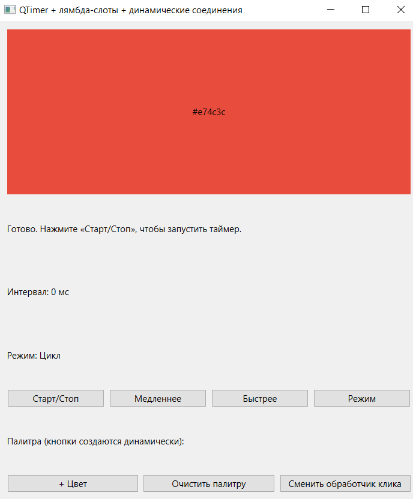
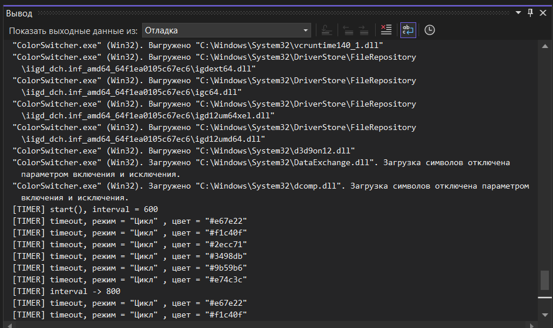

# Лабораторная работа №3. QTimer, лямбда-слоты и динамические соединения

**Дисциплина:** Основы кроссплатформенного программирования
**Тема:** QTimer, лямбда-слоты и динамические соединения
**Вариант:** Сквозной проект — Трекер задач (Task Tracker)

**Выполнил:** Красненькин Р. А.
**Группа:** ПИЖ-б-о-24-1
**Направление:** 09.03.04 «Программная инженерия»

**Год:** 2026

---

## Цель работы

Освоить класс `QTimer` для периодического и однократного выполнения кода, научиться использовать лямбда-функции в качестве слотов с корректным захватом и контекстом подключения, а также создавать, разрывать и переподключать соединения между сигналами и слотами динамически, во время выполнения программы. На практике закрепить это на приложении, которое переключает цвет фона по таймеру, реагирует на нажатия мыши и позволяет добавлять/удалять обработчики «на лету».

---

## Постановка задачи

Разработать GUI-приложение **ColorSwitcher** на Qt, демонстрирующее:

- **`QTimer`** — периодический и однократный запуск (через `singleShot`).
- **Лямбда-слоты** с корректным захватом переменных и контекстом подключения.
- **Динамические соединения** через `QMetaObject::Connection` и `disconnect()`.
- **Переподключение сигнала** на другой обработчик без пересоздания объекта.
- **Обработку событий мыши** через `mousePressEvent` и связку с собственным сигналом `colorChanged(QColor)`.
- **Три режима таймера:** Цикл / Случайный / Мигание.
- **Динамическое создание кнопок-цветов** с подключением их сигналов в рантайме.

---

## Теоретическое обоснование

**1. QTimer.** `QTimer` — объект, который по истечении заданного интервала излучает сигнал `timeout()`. Интервал задаётся в миллисекундах через `setInterval()` или `start(ms)`. Ключевые методы:
- `start()` — запускает повторяющийся таймер с текущим интервалом;
- `start(ms)` — запускает одноразово с указанным интервалом;
- `stop()` — останавливает;
- `isActive()` — проверяет, запущен ли;
- `QTimer::singleShot(ms, receiver, functor)` — однократный вызов без создания объекта.

**2. Таймер и цикл событий.** В отличие от консольного калькулятора из ЛР1, где мы читали `stdin` в блокирующем цикле `while`, таймер **не может работать без цикла событий** Qt. `QTimer` регистрируется в event loop и срабатывает, когда управление возвращается в `app.exec()`. Следствие: в GUI-приложении вызов `app.exec()` обязателен. Без него окно отрисуется один раз и «замрёт», таймер не тикнет ни разу, клики мыши не будут обработаны.

**3. Лямбда-слоты.** Начиная с Qt5, `connect()` принимает callable-объекты, включая лямбды:

```cpp
connect(sender, &Sender::signal, contextObject, [=](auto&... args) { /* тело */ });
```

Захват переменных критически важен:
- `[=]` — копирование всех внешних переменных. Безопасно, если переменные — значения.
- `[&]` — ссылка на внешние переменные. **Опасно:** локальная переменная может умереть раньше лямбды.
- `[this]` — захват указателя на объект-контекст. Стандарт для слотов класса.
- `[ptr]` — захват конкретного указателя.

**Опасный антипаттерн** — захват по ссылке локальной переменной:

```cpp
int interval = 500;
connect(&timer, &QTimer::timeout, [&interval]() { /* битая ссылка */ });  // ПЛОХО
```

Правильно — захват по значению или хранение состояния в полях класса и захват `[this]`.

**4. Контекст подключения (третий аргумент connect).** `connect(sender, &Sender::sig, context, functor)` — `context` «привязывает» жизнь соединения. Когда `context` уничтожается, Qt автоматически разрывает соединение, и лямбда больше не вызывается. Это связано с **деревом объектов QObject** из ЛР2: все соединения объекта автоматически рвутся при его удалении.

**5. Динамические соединения.** Соединение можно установить не только в конструкторе, но и в любой момент выполнения. Результат `connect()` — объект `QMetaObject::Connection`, который хранит идентификатор соединения:

```cpp
QMetaObject::Connection conn = connect(btn, &QPushButton::clicked, this, [this, btn]{ /* ... */ });
disconnect(conn);  // позже
```

Инструменты управления:
- `disconnect(conn)` — разрыв конкретного соединения.
- `Qt::UniqueConnection` — флаг, запрещающий дублирование.
- При удалении отправителя или контекста все его соединения рвутся автоматически.

Динамические соединения нужны, когда объекты создаются/уничтожаются в рантайме, поведение переключается «на лету», или один сигнал временно обслуживается другим обработчиком.

**6. Обработка нажатий: событие против сигнала.** В Qt есть два механизма:
- **События** — виртуальные методы виджета: `mousePressEvent()`, `keyPressEvent()`, `paintEvent()`. Переопределяются в подклассе, вызываются системой. К ним **нельзя** подключиться через `connect()`.
- **Сигналы** — высокоуровневые уведомления: `clicked()`, наш собственный `colorChanged()`.

В ЛР3 мы **комбинируем** оба механизма: холст переопределяет `mousePressEvent()`, а внутри **излучает собственный сигнал** `colorChanged(QColor)`, к которому главное окно подключается лямбдой. Событие — низкоуровневый вход, сигнал — удобный интерфейс для других объектов.

**7. Сообщения сборки: компилятор и линкер.** Три класса сообщений, которые нужно различать:
- `'X' was not declared in this scope` — **компилятор**: метод вызывается, но не объявлен в классе. Добавить объявление в `.h`.
- `multiple definition of 'X'` — **линкер**: одно определение попало в два `.o` (тело метода в `.h` и `.cpp`). Оставить тело только в `.cpp`.
- `undefined reference to 'X'` — **линкер**: объявление есть, а определения нет. Убедиться, что `.cpp` с телами входит в `SOURCES` и содержит определения с префиксом `Class::`.

Важное следствие для диагностики: `undefined reference` появляется только после успешной компиляции всех `.o`. Если бы `.cpp` не компилировался, `make` остановился бы раньше. Поэтому «компиляция зелёная, линковка падает на `undefined reference`» означает: файл реализации не участвует в сборке, либо содержит объявления вместо определений.

---

## Структура проекта

```
lab3-color-switcher/
├── .gitignore
├── README.md
├── ColorSwitcher.sln
├── ColorSwitcher/
│   ├── ColorSwitcher.vcxproj
│   ├── ColorSwitcher.pro
│   ├── main.cpp
│   ├── mainwindow.h / .cpp
│   ├── colorwidget.h / .cpp
│   └── palettebutton.h / .cpp
└── screenshots/
    ├── 01-window.png
    └── 02-debug-log.png
```

**Описание файлов:**

| Файл | Назначение |
|------|------------|
| `main.cpp` | Точка входа, `QApplication`, `app.exec()` |
| `mainwindow.h` / `.cpp` | Главное окно: таймер, режимы, динамические кнопки |
| `colorwidget.h` / `.cpp` | Холст: палитра, `paintEvent`, `mousePressEvent`, сигнал `colorChanged` |
| `palettebutton.h` / `.cpp` | Кнопка-цвет, создаётся динамически |

---

## Пример работы программы

### Скриншот 1. Главное окно ColorSwitcher



Окно содержит:
- холст с текущим цветом;
- кнопки «Старт/Стоп», «Медленнее», «Быстрее», «Режим»;
- панель динамической палитры: «+ Цвет», «Очистить палитру», «Сменить обработчик клика»;
- статус-строку;
- метки «Интервал» и «Режим».

### Скриншот 2. Лог в окне «Вывод → Отладка»



В логе видны:
- `[CREATE] ColorWidget` — создание холста;
- `[TIMER] start(), interval = 600` — запуск таймера;
- `[TIMER] timeout, режим = "Цикл" , цвет = "#e67e22"` — каждый тик таймера;
- `[TIMER] interval -> 800` — изменение интервала;
- `[TIMER] режим -> "Случайный" (переподключение timeout)` — смена режима;
- `[CREATE] PaletteButton "#d0560a"` — динамическая кнопка;
- `[DYNAMIC] создано соединение для "#d0560a", всего динамических: 1` — динамическое соединение;
- `[PALETTE] Добавлен цвет "#d0560a", всего: 7` — нажатие на кнопку-цвет;
- `[DESTROY] PaletteButton "#d0560a"` — удаление кнопки;
- `[CANVAS] переподключение colorChanged, альтернатива = true` — смена обработчика сигнала;
- `[TIMER] stop()` — остановка таймера.

---

## Разбор ошибок и их решений

**1. Некорректное отображение русского текста и предупреждения C4828.**
При первой сборке Visual Studio выдала предупреждения `C4828` («Файл содержит знак, начинающийся со смещения 0x..., который является недопустимым в текущей исходной кодировке») и ошибки `C2001: newline в константе`. Причина — файлы сохранялись в UTF-8 без BOM, а MSVC читает их как CP1251. Невидимые символы внутри строковых литералов «ломали» строки. **Решение:** все файлы пересохранены в **UTF-8 with BOM**, в свойствах проекта добавлен флаг компилятора **`/utf-8`**, проблемные строки с русским текстом набраны вручную. После этого предупреждения исчезли, текст отображается корректно.

**2. Ошибка `C2001: newline в константе` в `palettebutton.cpp` и `colorwidget.cpp`.**
При копировании кода из чата в строковые литералы попадали невидимые символы (разрывы строк, неразрывные пробелы). Компилятор «видел» незакрытую кавычку. **Решение:** проблемные строки набраны вручную в редакторе; файлы сохранены в UTF-8 with BOM. Дополнительно — флаг `/utf-8` в настройках проекта.

**3. Исключение драйвера Intel `ShaderCache` при запуске (не связано с кодом).**
При запуске программы в логе появилось `Вызвано исключение ... ShaderCache::ShaderCacheFileBackedEmptyCacheFileException`. Это **известная проблема драйверов Intel** при инициализации D3D — **не связана с кодом** и **не влияет** на работу программы. Qt использует Direct3D-ускорение, и драйвер бросает внутреннее исключение, которое Qt обрабатывает. Программа запускается и работает корректно. Решение: **игнорировать** — это особенность среды, а не ошибка приложения.

---

## Вывод

В ходе лабораторной работы изучен класс `QTimer` и механизм динамических соединений в Qt. Реализовано GUI-приложение **ColorSwitcher** с холстом, меняющим цвет по таймеру.

Освоено:
- создание `QTimer` с интервалом и его запуск/остановка;
- лямбда-слоты с захватом `[this]` и **обязательным контекстом** подключения;
- три режима таймера (Цикл, Случайный, Мигание) через **переподключение** сигнала `timeout()`;
- динамическое создание кнопок-цветов и их сигналов `clicked()` в рантайме;
- хранение идентификатора соединения в `QMetaObject::Connection` и его разрыв через `disconnect()`;
- переподключение обработчика сигнала `colorChanged` между двумя вариантами без пересоздания объекта;
- обработка событий мыши через `mousePressEvent` и связка «событие → сигнал»;
- различение ошибок компилятора и линкера.

Программа работает корректно: таймер стартует/останавливается, режимы переключаются, кнопки-цвета создаются динамически, соединения разрываются при очистке, обработчик сигнала переподключается. Логи в окне «Вывод → Отладка» подтверждают все этапы работы.

**Ссылка на Git-репозиторий:** https://github.com/Justake206/lab3-color-switcher

---

## Контрольные вопросы

**1. Что такое QTimer и какой сигнал он излучает по истечении интервала?**
`QTimer` — объект, который по истечении заданного интервала (в миллисекундах) излучает сигнал `timeout()`. Интервал задаётся через `setInterval()` или `start(ms)`. Подключив к `timeout()` любой слот, можно периодически выполнять код.

**2. Чем `start()` отличается от `start(ms)` и от `QTimer::singleShot()`?**
`start()` запускает **повторяющийся** таймер с текущим `interval()`. `start(ms)` — тоже повторяющийся, но с явно указанным интервалом (и перезаписывает `interval()`). `QTimer::singleShot(ms, receiver, functor)` — **однократный** вызов без создания объекта `QTimer`: через `ms` миллисекунд вызовется `functor` один раз.

**3. Почему QTimer не работает без `app.exec()`? Что такое цикл событий?**
`QTimer` регистрируется в **цикле событий Qt** (event loop) и срабатывает, когда управление возвращается в `app.exec()`. Без `exec()` цикл не запускается, таймер не получает «тик», сигнал `timeout()` не излучается. Цикл событий — это бесконечный цикл, который обрабатывает все входящие события (клики, таймеры, сигналы) по очереди.

**4. Чем GUI-приложение с таймером принципиально отличается от консольного калькулятора ЛР1, где `exec()` не вызывался?**
В ЛР1 использовался **блокирующий ввод** через `stdin` в цикле `while`. Программа ждала ввода — цикл событий был не нужен. В ЛР3 — **GUI-приложение**, таймер и клики мыши обрабатываются **через цикл событий**. Без `exec()` окно отрисуется один раз и «замрёт», таймер не сработает, клики не обработаются.

**5. Что произойдёт, если лямбда-слот захватывает `this`, но контекст подключения не передан?**
При **удалении `this`** соединение не разорвётся автоматически, и лямбда будет вызываться на **мёртвом объекте** — программа упадёт. **Правило:** если лямбда трогает `this` или поля класса — контекст `this` **обязателен** в третьем аргументе `connect()`.

**6. Зачем третий аргумент `connect()` (context object) и как он связан с деревом объектов ЛР2?**
Третий аргумент — **объект-контекст**. Когда контекст уничтожается, Qt **автоматически разрывает соединение**. Это связано с деревом объектов QObject: при удалении родителя удаляются дети, и все их соединения рвутся автоматически. Контекст гарантирует, что лямбда не будет вызвана после смерти объекта.

**7. Чем захват `[=]` отличается от `[&]`? Когда `[&]` опасен?**
`[=]` — **копирование** внешних переменных в замыкание. Безопасно для значений (числа, `QColor`, указатели на живые объекты). `[&]` — **ссылка** на внешние переменные. **Опасно**, если лямбда переживёт переменную: локальная переменная умрёт по выходу из скоупа, а лямбда останется — обращение к «мёртвой» памяти. Правильно — `[=]`, `[this]` или `[ptr]`.

**8. Что такое `QMetaObject::Connection` и как разорвать соединение по нему?**
`QMetaObject::Connection` — объект, который возвращает `connect()`. Хранит идентификатор конкретного соединения. Чтобы разорвать — вызывается `disconnect(conn)`. Если не хранить это поле, разорвать конкретное соединение нельзя — можно только `disconnect(sender, signal, ...)` для всех сразу.

**9. Что такое `Qt::UniqueConnection` и какую проблему решает?**
`Qt::UniqueConnection` — флаг, который передаётся в `connect()`. Запрещает **дублирование** одинаковых соединений. Без него при двойном `connect()` на одних и тех же объектах слот срабатывает N раз. С флагом — только один раз.

**10. Что будет, если вызвать одинаковый `connect()` дважды на одних объектах?**
Слот будет вызван **дважды** на каждый сигнал. Симптом: цвет «прыгает» на 2–3 позиции за тик вместо одной. Решение: `Qt::UniqueConnection` или явный `disconnect` перед повторным `connect`.

**11. Рвёт ли Qt соединения автоматически при удалении отправителя, получателя или контекста?**
Да. Qt **автоматически разрывает** все соединения, если удаляется **отправитель**, **получатель** или **контекст** соединения. Это обеспечивается деревом объектов QObject.

**12. Почему для удаления динамической кнопки лучше `deleteLater()`, чем `delete`?**
`deleteLater()` ставит объект в **очередь на удаление** — уничтожение произойдёт, когда управление вернётся в цикл событий. `delete` — **немедленно**, что опасно внутри обработчика сигнала этой же кнопки (она ещё участвует в текущем вызове). `deleteLater` — **безопасно**.

**13. Чем `mousePressEvent()` отличается от сигнала `clicked()`? Можно ли подключиться к событию через `connect()`?**
`mousePressEvent()` — **виртуальный метод** виджета, переопределяется в подклассе, вызывается системой при клике. Это событие, не сигнал. `clicked()` — **сигнал** `QPushButton`, излучается после нажатия. К событию **нельзя** подключиться через `connect()` — только переопределить в подклассе. К сигналу `clicked()` — можно.

**14. Что такое `eventFilter()` и когда он удобнее переопределения виртуального метода?**
`eventFilter()` — механизм **перехвата событий** без создания подкласса. Устанавливается через `installEventFilter()`. Удобен, когда нужно перехватить события **чужого** виджета (без его модификации) или **многих виджетов** одним фильтром. Переопределение виртуального метода удобнее, когда событие относится только к **своему** классу.

**15. Как реализовать мигание одним таймером без второго таймера?**
Один `QTimer` вызывает `toggleBlink()` — переключает флаг `m_blinkOn`. При `paintEvent` цвет выбирается: если `m_blinkOn` — рисуем **чёрный**, иначе — **текущий**. Так мигание реализуется **одним** таймером и **одним** флагом, без второго таймера.

**16. Что произойдёт, если менять `interval()` у активного таймера?**
`setInterval()` у активного таймера **перезапускает** таймер с новым интервалом. Следующий тик произойдёт через новое количество миллисекунд от момента изменения. В нашем коде «Медленнее/Быстрее» работают именно так — меняют `interval()` на лету.

**17. Почему состояние режима хранится в поле `m_mode`, а не захватывается в лямбду?**
Лямбда `[this]` **читает актуальное значение** `m_mode` при каждом вызове. Если захватить `[mode]` по значению — лямбда «запомнит» старое значение и **не увидит изменений**. Состояние в поле — правильный подход: лямбда видит **текущее** значение. Это и демонстрирует переподключение таймера при смене режима.

**18. Как проверить срабатывание `timeout` в юнит-тесте без реального ожидания?**
Через **`QSignalSpy`** (модуль QtTest). Подключаем spy к `QTimer::timeout`, запускаем таймер, ждём `spy.wait(ms)` — spy считает срабатывания. Или используем `QTest::qWait(ms)`. Второй вариант — вызвать `timeout()` напрямую через `QMetaObject::invokeMethod` для тестирования слота без таймера.

**19. Можно ли использовать `QTimer` в потоке без цикла событий? Что для этого нужно?**
**Нет**, `QTimer` требует цикла событий. В потоке без `exec()` таймер не сработает. Если нужен таймер в отдельном потоке — в этом потоке запускается **свой цикл событий**: либо через `QThread::exec()`, либо через `QEventLoop`. Либо используется `QTimer::singleShot` с `Qt::DirectConnection` — но это уже не «настоящий» периодический таймер.

**20. Как динамические соединения связаны с автоудалением детей из ЛР2 при очистке палитры?**
В `clearPaletteButtons()` сначала **явно разрываются** динамические соединения через `disconnect(conn)`, затем кнопки удаляются через `deleteLater()`. Даже если бы мы не разорвали соединения вручную — Qt разорвал бы их автоматически при удалении кнопок (дерево объектов ЛР2). Явный разрыв — **наглядная демонстрация** работы с `QMetaObject::Connection`.

**21. Чем сообщение компилятора `not declared in this scope` отличается от сообщения линкера `undefined reference` и как по-разному чинить каждый?**
- **`not declared in this scope`** — **компилятор**: метод вызывается, но **не объявлен** в классе. Исправление: **добавить объявление** в `.h`.
- **`undefined reference`** — **линкер**: объявление есть, **определения нет** ни в одном `.o`. Исправление: убедиться, что `.cpp` с телами входит в `SOURCES` и содержит определения с `Class::`.

**22. Почему `multiple definition` возникает, когда тело метода есть и в `.h`, и в `.cpp`, и как это исправить?**
В `.h`-файле тело метода **автоматически inline** (если это метод класса). Если тело продублировать в `.cpp` — получается **два определения**. Линкер не знает, какое выбрать. Исправление: **оставить тело только в одном месте** — либо в `.h` (inline), либо в `.cpp` с `Class::`.

**23. Если компиляция прошла без ошибок, но линковка падает на `undefined reference` по всем слотам класса — где искать причину и почему это важно?**
Причина — **файл `.cpp` не даёт определений**: либо не участвует в сборке (не добавлен в `SOURCES`/проект), либо содержит **копию заголовка** вместо реализации, либо методы определены **без префикса `Class::`**. Важно, потому что «зелёная компиляция» означает, что `.cpp` **синтаксически** верен, но не гарантирует, что `.cpp` **содержит определения** — это проверяет только линкер. Диагностика: проверить `SOURCES`, открыть `.cpp` и убедиться, что там реально `void Class::method() { ... }`.

---

## Ссылка на репозиторий

**GitHub:** https://github.com/Justake206/lab3-color-switcher

**Сквозной проект:** https://github.com/Justake206/task-tracker

---
